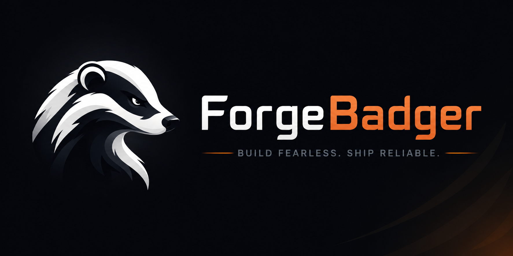

<p align="center">
  
</p>

<h1 align="center">ForgeBadger</h1>

<p align="center"><strong>One local workspace for your AI coding tools.</strong></p>

<p align="center">
  <a href="https://www.npmjs.com/package/forgebadger"></a>
  <a href="https://nodejs.org/"></a>
  <a href="https://github.com/Lanzhou3/ForgeBadger/blob/dev/LICENSE"></a>
</p>

[简体中文](docs/README.zh-CN.md) · [繁體中文](docs/README.zh-TW.md)

**Claude Code · Codex · OpenCode · Kimi Code · Pi · MiniMax Code**

ForgeBadger is a local workspace for your AI coding CLIs. Manage projects and
terminals, get help from Copilot, and connect your own agents through MCP.
Run it on your computer or a trusted private host.

[Quick start](#quick-start) · [Features](#features) · [MCP](#connect-your-agents-through-mcp) · [Documentation](#documentation) · [Contributing](#contributing)

## Quick start

Install the current beta and start the bundled Gateway and Web console:

```bash
npm install -g forgebadger@beta
forgebadger start
```

Open the **Web Console URL printed in your terminal**. New beta installations default
to `http://127.0.0.1:18333` (Gateway: `http://127.0.0.1:18332`); existing saved ports
are retained. Keep the start command running while you use the console.

The first start creates local runtime configuration and generates the required
secrets automatically. **No repository clone, pnpm, manual build or `.env` setup
is needed for npm installation.**

**Before you start:** use Node.js **20.12 through 24**. Install and authenticate the
AI CLI tools you want to use separately, and make sure their commands are on `PATH`.
ForgeBadger bundles its Web console and terminal backend; it does not install the
AI CLIs for you. Run `forgebadger doctor` to check your environment and see install
hints for missing tools.

| npm channel | Install command | Use it for |
| --- | --- | --- |
| `beta` | `npm install -g forgebadger@beta` | The current features described in this README; opt-in prerelease testing |
| `latest` | `npm install -g forgebadger` | The previous stable release; it may not include current beta features |

Beta does not replace `latest`. Known regression and platform limitations are
recorded in the [release plan](docs/RELEASE-PLAN.md). Physical Windows/ConPTY and
WSL acceptance remain release caveats. Native dependencies may require a C/C++
build toolchain when a compatible prebuilt binary is unavailable.

### Your first session

1. Open the console and create your local account.
2. Import an existing project or create one with a reusable template.
3. Select an installed AI CLI and launch its terminal session.
4. Configure models in **Models**, reuse **Skills** and **Templates**, or open
   **Copilot** for project-aware assistance as needed.

## Features

| Area | What you can do |
| --- | --- |
| **Projects & configuration** | Create/import projects, preview CLI configuration and reuse templates from local projects or public Git repositories. |
| **Persistent terminals** | Run multiple AI CLI sessions in the browser. Reconnect after a browser disconnect or Gateway restart while the Session Server remains alive. |
| **Model Center** | Manage provider/model profiles and encrypted credentials. Explicitly apply a selection to each CLI's native global configuration with backup and rollback. |
| **Copilot** | Work with a built-in assistant that uses project context and platform tools to help with development. |
| **Project Manager & Workspaces** | Organize goals, tasks, acceptance criteria and evidence; use isolated worktrees for verification, review and explicit delivery. |
| **Skills, Agents & templates** | Manage reusable instructions and project setup across your CLI workflows. |
| **MCP for external agents** | Let compatible agents read and operate on selected projects through scoped, revocable access tokens. |
| **Visibility & diagnostics** | Inspect session status, notifications, usage and history; export local diagnostics and explore a read-only code graph with optional CodeGraph tooling. |

### Supported AI CLIs

| CLI | Command ForgeBadger detects |
| --- | --- |
| Claude Code | `claude` |
| Codex | `codex` |
| OpenCode | `opencode` |
| Kimi Code | `kimi` |
| Pi | `pi` |
| MiniMax Code | `mcode` |

Sessions use each CLI's existing host configuration and credentials. Model Center
changes are explicit: applying a provider writes that CLI's user-level config;
launching a session does not inject provider secrets into its environment.

### Connect your agents through MCP

Enable MCP in **Settings**, restart ForgeBadger, then create an access token for
the projects and capabilities you want to share. Connect an agent that supports
**MCP Streamable HTTP** using the configuration shown in the console.

MCP tools cover project inspection, task planning, authorized CLI task dispatch,
review and selected lifecycle operations. Agents act within the token's project
and capability grants; sensitive native CLI prompts still require the owner.
See the [MCP API reference](docs/API.md#external-mcp-endpoint) for the tools,
configuration and authorization boundaries.

## CLI & local data

| Command | Purpose |
| --- | --- |
| `forgebadger start` | Start the Gateway and Web console |
| `forgebadger doctor` | Inspect dependencies without creating runtime state |
| `forgebadger --version` | Show the installed version |

Runtime state is stored in `~/.forgebadger` by default. Project repositories and
native AI CLI configuration remain in their own locations.

<details>
<summary><strong>Custom ports and a separate state directory</strong></summary>

```bash
forgebadger start --gateway-port 18342 --web-port 18343
```

Set `FORGEBADGER_STATE_DIR` to keep multiple installations separate. For example,
in a POSIX shell:

```bash
FORGEBADGER_STATE_DIR=/private/path/forgebadger-state forgebadger start
```

Use a separate state directory and database for each instance. The Web console
uses the Gateway URL selected at startup.

</details>

<details>
<summary><strong>Backup and restore</strong></summary>

```bash
forgebadger backup --output /private/path/new-backup
# Stop the Gateway and Web processes before restoring.
forgebadger restore --from /private/path/new-backup --to /private/path/new-state
# POSIX shell; clear any old FORGEBADGER_DB_PATH override first.
FORGEBADGER_STATE_DIR=/private/path/new-state forgebadger start
```

Backup captures the SQLite database and effective runtime config, **including
its encryption key and JWT secret**. Keep it private; it is not an encrypted
archive. Restore validates the backup, requires a new destination, preserves
the encryption key, rotates browser authentication and requires a new sign-in.

Back up project repositories and native CLI configuration separately. Running
terminals, terminal history and filesystem-side CLI config backups are not included;
restoring session metadata does not recreate processes. See the
[workflow and recovery guide](docs/PERSONAL-TEAM-WORKFLOWS.md) for the full scope.

</details>

<details>
<summary><strong>Uninstall</strong></summary>

```bash
forgebadger uninstall --backup /private/path/new-backup
npm uninstall -g forgebadger
```

Stop Gateway and Web first. The first command backs up and then removes local
ForgeBadger state after confirmation; the second removes the npm package.
State includes the database and encryption key, so keep your backup before
removing it. `npm uninstall -g forgebadger` alone leaves runtime state in place.

</details>

## Architecture

```text
Browser / Web console
  -> Gateway (HTTP + WebSocket)
  -> independent Session Server (node-pty)
  -> AI CLI processes
```

The Gateway owns project access, SQLite, credentials and CLI processes. The Web
console is a Next.js SPA. Session Server owns the live terminals, which lets
sessions survive browser disconnects and Gateway restarts.

Terminal history lives in the Session Server's rendered screen, not SQLite.
Daemon shutdown or an OS restart ends those processes; they are not silently
recreated. See [architecture](docs/TECH-ARCHITECTURE.md) for the implementation.

## Develop from source

<details>
<summary><strong>Local setup and verification</strong></summary>

Use a supported Node.js version and the root `packageManager` version
(currently `pnpm@12.6.0`).

```bash
git clone https://github.com/Lanzhou3/ForgeBadger.git
cd ForgeBadger
git switch dev
pnpm install --frozen-lockfile
```

Create a root `.env` with the following values. Generate a fresh secret for each
secret variable using `openssl rand -hex 32`; replace the placeholders and never
commit this file.

```dotenv
FORGEBADGER_MASTER_KEY=<64-hex-characters>
FORGEBADGER_JWT_SECRET=<at-least-32-characters>
FORGEBADGER_PORT=18332
FORGEBADGER_WEB_PORT=18333
NEXT_PUBLIC_GATEWAY_URL=http://127.0.0.1:18332
```

```bash
pnpm dev
```

Open `http://127.0.0.1:18333`. Unlike npm installation, source development
requires this `.env` setup.

```bash
pnpm -r typecheck
pnpm -r test
node --test scripts/*.test.mjs
pnpm -r build
```

Release packaging: `pnpm build:npm`, `pnpm verify:npm`, `pnpm smoke:npm`.
Use the [release procedure](docs/RELEASE-PLAN.md) for the complete gates.

```text
packages/cli/       Published npm CLI and bundled runtime
packages/gateway/   API, WebSocket, Session Server, SQLite, CLI adapters
packages/web/       Next.js, React, Tailwind CSS, xterm.js
scripts/            Packaging, validation and test harnesses
docs/               Product, architecture, API and operations guides
```

</details>

## Documentation

| Get started & operate | Build & contribute |
| --- | --- |
| [Trial runbook](docs/TRIAL-RUNBOOK.md) | [Architecture](docs/TECH-ARCHITECTURE.md) |
| [First-run checklist](docs/TRIAL-CHECKLIST.md) | [API reference](docs/API.md) |
| [Troubleshooting](docs/TROUBLESHOOTING.md) | [Test plan](docs/TEST-PLAN.md) |
| [Workflow & recovery](docs/PERSONAL-TEAM-WORKFLOWS.md) | [Development plan](docs/DEVELOPMENT-PLAN.md) |
| [Feedback template](docs/TRIAL-FEEDBACK.md) | [Release plan](docs/RELEASE-PLAN.md) |
| [Diagnostics](docs/SUPPORT-DIAGNOSTICS.md) | [External evidence gates](docs/EXTERNAL-EVIDENCE-GATES.md) |

## Contributing

Try the beta, report a reproducible bug, improve the docs or contribute code.
Use the [trial feedback form](.github/ISSUE_TEMPLATE/forgebadger-trial-feedback.yml)
or [open an issue](https://github.com/Lanzhou3/ForgeBadger/issues).
Read the [contribution guide](CONTRIBUTING.md) before opening a pull request.

ForgeBadger runs on a trusted local/private host. MCP project grants are not a
sandbox for untrusted code. Keep backups and credentials private; redact secrets
from logs, terminal captures and issues. Report vulnerabilities through the
[security policy](SECURITY.md).

## License

[MIT](LICENSE). Happy coding!
